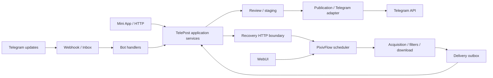
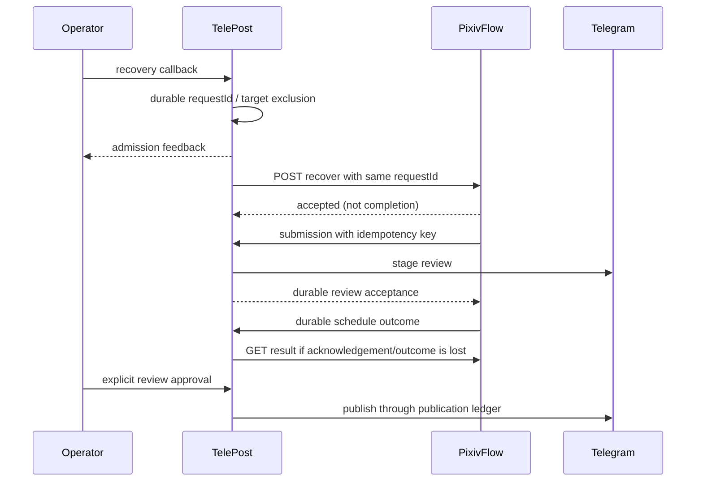
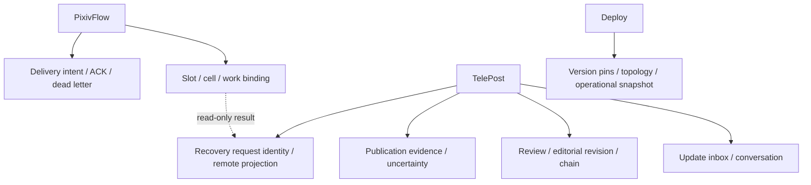
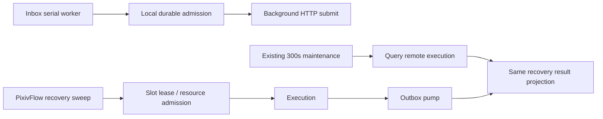
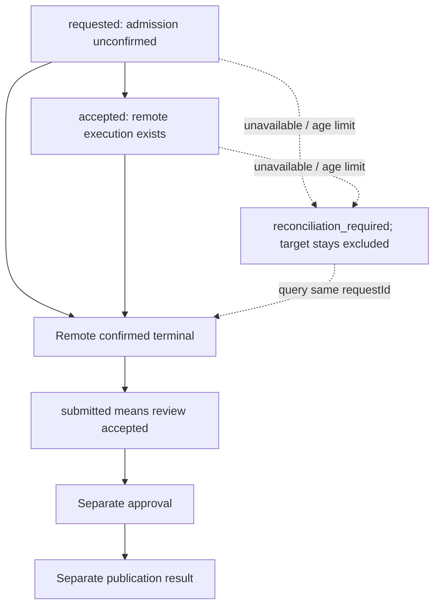
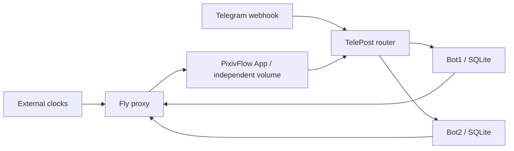

# Recovery ownership and modularity

Status: DELIVERED (first slice: TelePost 2.84.9 #360, PixivFlow 3.7.2 #212, deploy pin #273; production acceptance 2026-10-25 in operations/current-state.md)
Scope: TelePost / PixivFlow / Deploy

## Decision

Keep the two independently usable products and their existing process boundaries.
Converge execution decisions on PixivFlow's slot/cell ledger, and review/publication
decisions on TelePost's application services. TelePost recovery rows are a durable
command identity and a remote-result projection, not another execution scheduler.
Do not add a central core service, event bus, plugin SDK, database, or worker.

This is a bounded first simplification slice, not completion of every architecture
change. Runtime and release evidence belongs in operations/current-state.md.

## Inventory and measured baseline

Counts below describe the explicitly inspected scope, not an inferred whole-repo
complexity score. State names alone do not measure complexity.

| Mechanism | Code authority | Count / role | Classification |
| --- | --- | --- | --- |
| Execution cell FSM | PixivFlow `src/scheduler/SlotStateMachine.ts` | 8 states, 20 non-self edges; 4 terminal states | Necessary execution semantics |
| Slot aggregate | same module, `aggregateSlot` | 5 derived values; no independent transition table | Projection, not a second FSM |
| Refetch generation | TelePost `telepost/domain/refetch_state.py` | 9 states, 26 non-self edges | Review replacement lifecycle; not equivalent to schedule recovery |
| Recovery command | TelePost `telepost/application/recovery.py` | Before: requested/accepted/failed; two local age-based failure branches | Accidental execution-owner duplication |
| Review/publication | TelePost `review_queue.py`, `review_service.py`, publication service and delivery ledger | Separate approval and external-send boundaries; no global state count claimed | Necessary business and Telegram uncertainty |
| Update inbox | TelePost `telepost/telegram/inbox_worker.py`, SQLite inbox repository | One serial worker per Bot; max five attempts | Necessary inbound crash recovery |
| Delivery outbox | PixivFlow `src/delivery/OutboxWorker.ts` | One pump; intent leases, retry and dead letter | Necessary outbound side-effect recovery |
| Slot recovery sweep | PixivFlow `MultiScheduleManager.startRecoveryLoop` | One timer combines interrupted-slot recovery and stall sweep | Execution owner's recovery |
| TelePost repeated jobs | `main.py` setup before this slice | Four registrations: maintenance 300s, refetch poll, refetch event reconciliation, supply watchdog | Different subjects; not all duplicates |
| Registration verification | TelePost webhook lifecycle, this slice | One additional 60s job only in webhook mode | External registration health, independent of queue depth |
| Storage | TelePost `database/db_manager.py`; PixivFlow repositories | Per-Bot SQLite; separate execution SQLite; no new DB | Isolation and unique owners |
| Runtime | TelePost `fly.toml`; Deploy `fly/deploy.pixivflow.toml` | Always-on TelePost router + two Bot children; independent sleeping PixivFlow worker | Different lifecycle and credential boundaries |

TelePost also registers primary-Bot daily log cleanup and PixivFlow CLI maintenance,
plus automation loading. The local PixivFlow package in TelePost's Dockerfile and
`utils/maintenance_jobs.py` is a coupling candidate, not removed in this slice:
standalone compatibility and remaining CLI callers need an inventory before removal.
HTTP timeout timers are not counted as independent workers. TelePress, static WebUI,
Mini App and deployment clocks remain adapters/integrations, not new execution owners.

## Component dependencies



## Business calls



## Data ownership



## Async execution



## State relationships



## Production topology



No deployment consolidation is justified by these findings. Different runtimes,
idle policies, credentials, and failure domains remain useful boundaries.

## Responsibility and deletion matrix

| Responsibility | Owner / why | Apparent duplication | Decision / proof |
| --- | --- | --- | --- |
| Accept recovery command | TelePost; stable human action identity | Remote accepts execution separately | Keep both; lost-response tests retain same ID |
| Queue / execute / time out | PixivFlow scheduler, resource admission, slot lease | TelePost age-based failure | Remove two local failure branches; remote-running regression fails before repair |
| Retry inbound update | TelePost inbox | Outbox also retries | Keep: different source, payload and side-effect boundary |
| Retry delivery | PixivFlow outbox | Telegram staging retries | Keep: HTTP intent versus Telegram throttling; same submission key protects replay |
| Review reconciliation | TelePost review service | Slot recovery also reconciles | Keep: review card/staging versus acquisition execution |
| Recovery result notification | PixivFlow durable outbox + TelePost notification receipt | Result projection missing | Apply result separately from notification ACK; retries converge by requestId/target/slot |
| Unknown remote result | TelePost projection | Previously invented terminal failure | Keep target exclusion and explicit reconciliation flag; no new execution identity |
| Publication success | TelePost publication ledger | PixivFlow success copy claimed published | Correct copy: delivery success is not publication |
| History | Each domain's existing ledger | Agent docs claimed final truth | Docs are timestamped evidence, never a new business store |

There is a bidirectional service dependency, but it represents commands and results.
Replacing it with a central event bus would retain the same uncertainty and add an
operational component. Polling is compensation for lost results, not a second scheduler.

## Architecture options

| Dimension | A: simplify existing services | B: cross-language modular monolith | C: plugin runtime |
| --- | --- | --- | --- |
| Complexity / debugging | Remove duplicate decisions; local SQLite + transport fakes | Cross-language embedding or rewrite required | Adds loading/version/ownership contracts |
| Deployment / performance | Existing two products; no measured performance claim | May reduce HTTP, may increase shared resource contention | Same process possible only within a compatible runtime |
| Reliability / isolation | Existing Bot and worker boundaries retained | Shared process lifecycle changes proven isolation | Plugin isolation depends on host, not interface names |
| Unit / E2E testing | Existing application paths and persisted stores | Potentially simpler E2E after expensive migration | Contract tests required for each real implementation |
| Compatibility / migration | Additive fields and existing GET API | High migration cost and data/runtime risk | Moderate to high if exposed as public SDK |
| Single maintainer / Agent cost | Smallest current slice and review surface | Two-language integration remains costly | Ongoing plugin compatibility overhead |
| Recommendation | Implement now | Defer pending measured deployment benefit | Use existing adapters; no speculative framework |

Filters, media conversion, delivery targets and optional preview providers are
appropriate extension seams. Transactions, authorization, review transitions and
publication evidence remain core-owned. An additional real implementation is the
gate for a new registration interface; folder reorganization is not a deliverable.

## Community research and reuse

RFC 9110 §15.3.3 defines 202 as acceptance without completed processing; §9.2.2
requires idempotent semantics before automatic retries of non-idempotent methods.
Source: https://www.rfc-editor.org/rfc/rfc9110.html

Telegram provides getWebhookInfo and setWebhook, including explicit preservation
of pending updates. Source: https://core.telegram.org/bots/api#getwebhookinfo
Use the already installed PTB client and JobQueue. Existing SQLite, slot leases,
outbox, and authenticated recover query cover this slice; a new queue product or
workflow engine would add deployment and migration cost without fixing ownership.
No new dependencies, licenses, runtime services or plugin frameworks are introduced.

## Local debug contract

Run TelePost's real application services and temporary SQLite with fake transport:

```sh
python -m pytest -q --no-cov -o log_cli=false tests/test_recovery_reconciliation.py tests/test_recovery_answer_first.py tests/test_staging_recovery.py tests/test_submission_timeout_idempotency.py tests/test_update_inbox.py tests/test_review_service.py tests/test_webhook_registration.py
```

Required external services, real tokens, Fly access and production DBs: **zero**.
Before this slice, a red deterministic two-case regression demonstrates that both
requested and accepted age limits release a remotely running task. After repair,
the same request remains active and a second click is refused. This improves
coverage and diagnosis; it does not claim that pre-existing tests required three
services. Measured timings and full-suite results are tracked in current-state.

Keep staged-media budget, empty-payload guard, publication uncertainty and inbox
restart tests; these use the actual production repositories/state machines.
Do not replace persisted transaction tests with an in-memory mock repository.

## Deferred work and compatibility

- Existing terminal history is not rewritten or automatically replayed.
- A remote query outage or missing old request can remain reconciliation-required;
  automatic unlock is unsafe without cancellation/fencing evidence.
- Refetch generation replacement remains its own lifecycle; no blanket merger
  with schedule recovery is authorized by similarity of names.
- Two 30s refetch jobs may share observations, but removal needs event-ACK and
  replacement-race evidence. No reduction in those worker counts is claimed.
- No performance benchmark or cost evidence justifies co-location or a language rewrite.
- Additive recovery columns permit an old binary to open the DB, but rollback to
  the old age-based policy restores the known consistency defect.
